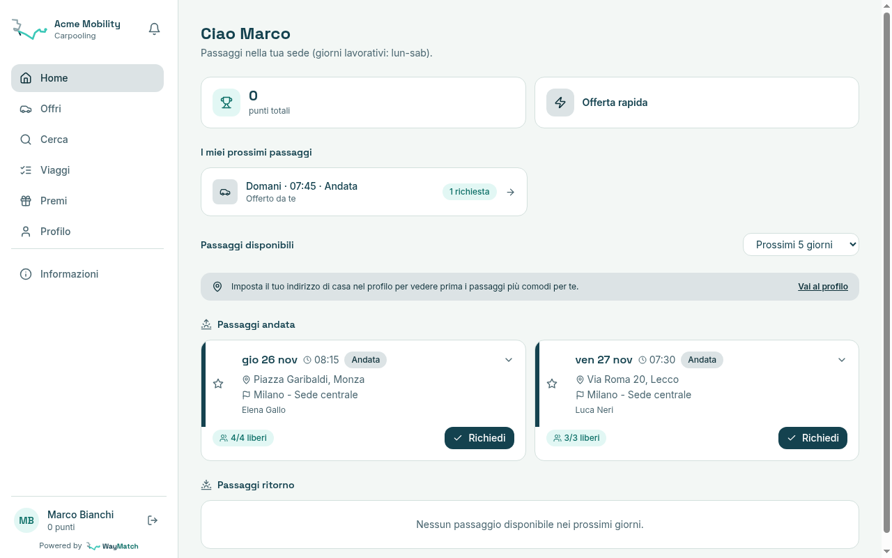

<p align="center">
  
</p>

# WayMatch

> **Publication in progress.** The code is arriving in reviewed blocks. Version 1.0.0 is on its
> way: until then some links on this page do not work yet.

**Two roads, one way.** WayMatch is a free, self-hosted carpooling platform for companies with one
site or many: you install it on your own server, with your own brand.

Colleagues who travel the same way find each other, share the car to work and earn points they can
redeem for rewards. The company sees how many kilometres, how much CO2 and how much money it saves.
It works on desktop, and on the phone it installs like any other app, without going through the
app stores.

<p align="center"></p>

## Why WayMatch

- No subscription, no user limits, no paid tier. [**Truly free.**](#what-does-it-cost-nothing)
- It runs on your server with an encrypted database, and maps and address search come from providers
  you choose. [**Your data stays yours.**](docs/sicurezza.md)
- Your company's logo, name and colours in the app and in the phone icon. **Your brand.**
- Docker install in minutes, automatic HTTPS, one-command backup and restore, and it works without
  email and without SSO. [**IT-friendly.**](docs/installazione.md)
- Checked against the WCAG 2.1 AA accessibility guidelines, usable from the keyboard.
  [**Accessible to everyone.**](docs/funzionalita.md)

## Quick start (5 minutes)

```bash
git clone https://github.com/waymatch/waymatch.git && cd waymatch
cp .env.example .env
# set JWT_SECRET and DB_ENCRYPTION_KEY in .env (each: openssl rand -hex 32)
docker compose up -d --build
# open http://localhost:7777 and follow the guided setup
```

## Language

The app and its documentation are currently in **Italian**. The guides are in [docs/](docs/README.md).

## What does it cost? Nothing.

WayMatch is free for internal business use. The author asks for one thing only, and it is not a
condition of the licence: *I made this for you; do something for someone else*, as you choose.
Details (in Italian): [PRICING.md](PRICING.md). Companies using WayMatch can say so in
[ADOPTERS.md](ADOPTERS.md).

## Licence

[PolyForm Internal Use 1.0.0](LICENSE): you may install, study and modify it for your internal
business. You may **not** resell it, offer it as a service to others or redistribute it. Copyright
notice and credits (*Andrea Crestani*) must be kept. It is source-available, not "open source" in the
OSI sense.

Contributions are welcome ([CONTRIBUTING.md](CONTRIBUTING.md)); security issues privately
([SECURITY.md](SECURITY.md)).
