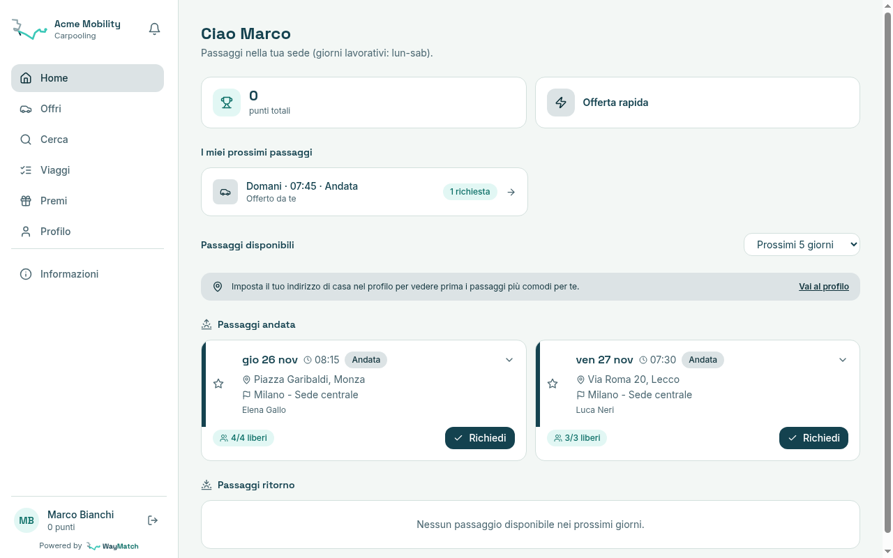
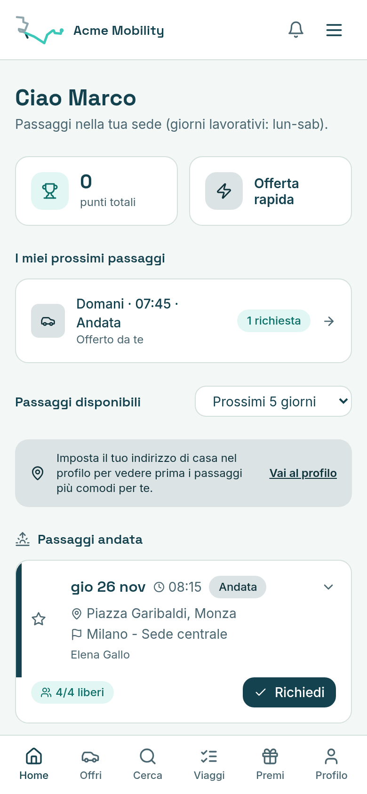
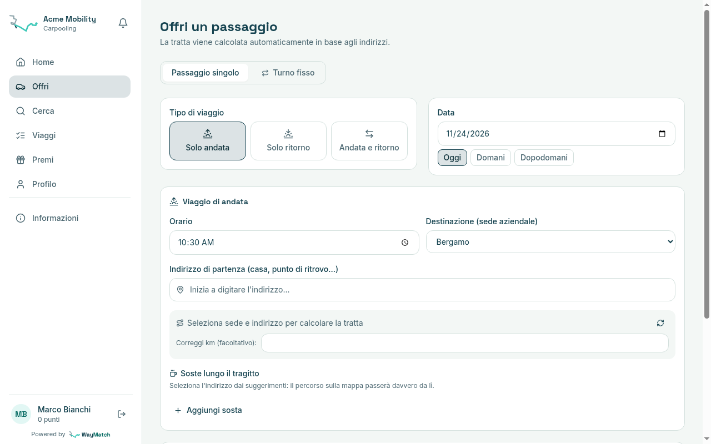
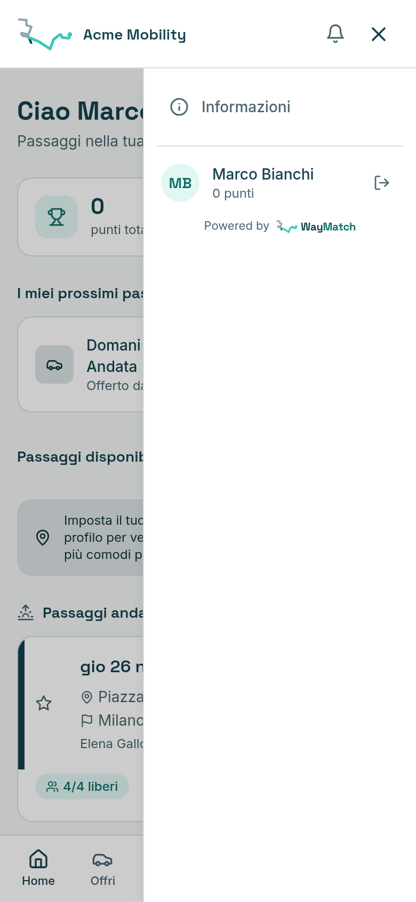

<p align="center">
  
</p>

<p align="center">
  <a href="https://github.com/waymatch/waymatch/releases"></a>
  <a href="https://github.com/waymatch/waymatch/actions/workflows/test.yml"></a>
  <a href="LICENSE"></a>
  <a href="docs/funzionalita.md"></a>
</p>

# WayMatch

> **Pubblicazione in corso.** Il codice arriva a blocchi, ognuno rivisto prima di entrare. La
> versione 1.0.0 è in arrivo: fino ad allora alcuni collegamenti di questa pagina non funzionano.

**Due strade, una via.** WayMatch è una piattaforma di carpooling aziendale gratuita e self-hosted,
per aziende con una sola sede o con tante: la installate sul vostro server, con il vostro marchio.

I colleghi che fanno la stessa strada si trovano e vanno al lavoro insieme: chi guida offre un
passaggio, chi non guida lo chiede, e tutti guadagnano punti da cambiare in premi. L'azienda vede quanti chilometri, quanta CO2 e quanti costi
risparmia. Si usa dal computer e sul telefono si installa come una normale app, ma senza passare
dagli store.

<table>
  <tr>
    <td width="68%"></td>
    <td width="32%"></td>
  </tr>
  <tr>
    <td></td>
    <td></td>
  </tr>
</table>

## Perché WayMatch

- Nessun abbonamento, nessun limite di utenti, nessuna versione a pagamento.
  [**Gratuito, davvero.**](#quanto-costa-niente)
- Gira sul vostro server, con il database cifrato, e le mappe e la ricerca degli indirizzi arrivano dai
  fornitori che scegliete voi. [**I dati restano vostri.**](docs/sicurezza.md)
- Logo, nome e colori della vostra azienda nell'app e nell'icona sul telefono. [**Con il vostro
  marchio.**](#il-vostro-logo-i-vostri-colori)
- Si installa con Docker in pochi minuti, con HTTPS automatico, backup e ripristino con un comando, e
  funziona anche senza email e senza SSO. [**Pronto per l'IT.**](docs/installazione.md)
- Verificato secondo le linee guida di accessibilità WCAG 2.1 AA, si usa anche da tastiera.
  [**Accessibile a tutti.**](docs/funzionalita.md)

## Cosa fa

**Per chi viaggia.** Offri un passaggio in pochi tocchi, anche ogni giorno alla stessa ora con i turni
fissi. Trovi i colleghi che passano vicino a casa tua, chiedi un posto e ricevi la conferma sul
telefono. Ogni viaggio condiviso vale punti, che scalano la classifica e si cambiano in premi.

**Per il mobility manager.** Gestisci dipendenti (anche da un file), sedi e giorni lavorativi. Decidi
le regole dei punti, i premi, i contest e i voucher, e pubblichi i documenti da accettare, come
l'informativa privacy. I report ti dicono quanti chilometri, quanta CO2 e quanti costi avete
risparmiato, e si esportano in Excel e PDF.

**Per l'IT.** Un container, un file di configurazione, dati cifrati, ruoli e registro delle attività,
e i diritti GDPR (esportazione e cancellazione dei dati) già pronti.

Tutte le funzioni, una per una: [docs/funzionalita.md](docs/funzionalita.md).

## Prova rapida (5 minuti)

```bash
git clone https://github.com/waymatch/waymatch.git && cd waymatch
cp .env.example .env
# in .env imposta JWT_SECRET e DB_ENCRYPTION_KEY (ciascuno: openssl rand -hex 32)
docker compose up -d --build
# apri http://localhost:7777 e segui la configurazione guidata
```

Per un'installazione in produzione (dominio, HTTPS, backup, aggiornamenti):
[guida all'installazione](docs/installazione.md).

## Documentazione

| Per chi | Cosa |
|---|---|
| Chi usa l'app | [Guida per gli utenti](docs/guida-utente.md) · [Novità](docs/novita.md) |
| Mobility manager | [Guida per il mobility manager](docs/guida-mobility-manager.md) |
| IT e sicurezza | [Installazione](docs/installazione.md) · [Sicurezza](docs/sicurezza.md) · [Mappe sul proprio server](docs/tile-self-hosted.md) |
| Sviluppatori | [Per chi sviluppa](docs/sviluppo.md) · [Funzionalità](docs/funzionalita.md) · [CHANGELOG](CHANGELOG.md) |

Le guide per utenti e mobility manager sono anche dentro l'app, alla voce **Informazioni**, sempre
allineate alla versione installata.

## Il vostro logo, i vostri colori

WayMatch è la piattaforma; **l'azienda ci mette la propria identità**. Dalle impostazioni il mobility
manager carica logo, nome e colori: l'azienda compare nell'intestazione, nella pagina di accesso e
nell'icona dell'app sul telefono. WayMatch resta discreto, in fondo al menu e nella pagina
Informazioni. Lo sfondo e i testi restano quelli di WayMatch, così la lettura è sempre confortevole: se
i colori scelti hanno poco contrasto, le impostazioni lo segnalano e propongono la variante leggibile
più vicina.

## Quanto costa? Niente.

WayMatch è **gratuito per l'uso interno delle aziende**. Chi l'ha scritto chiede una cosa sola, e non è
una condizione della licenza: *io l'ho fatto per voi, voi fate qualcosa per qualcun altro*, a vostra
scelta. Tutto in [PRICING.md](PRICING.md).

## Adottato da

Le aziende che usano WayMatch e scelgono di dirlo: [ADOPTERS.md](ADOPTERS.md).

## Licenza

[PolyForm Internal Use 1.0.0](LICENSE): potete installarlo, studiarlo e modificarlo per le vostre
attività interne. **Non** si può rivendere, offrire come servizio a terzi né ridistribuire: deve
restare gratuito per tutti. La nota di copyright e i crediti (*Andrea Crestani*) devono restare. Non è
"open source" in senso stretto (la definizione ufficiale ammette anche l'uso commerciale): è software
con sorgente disponibile.

## Contribuire

Segnalazioni, idee e correzioni sono benvenute: [CONTRIBUTING.md](CONTRIBUTING.md). Per le
vulnerabilità, in privato: [SECURITY.md](SECURITY.md).

<p align="center"><sub>Fatto da Andrea Crestani · <a href="README.en.md">English</a></sub></p>
