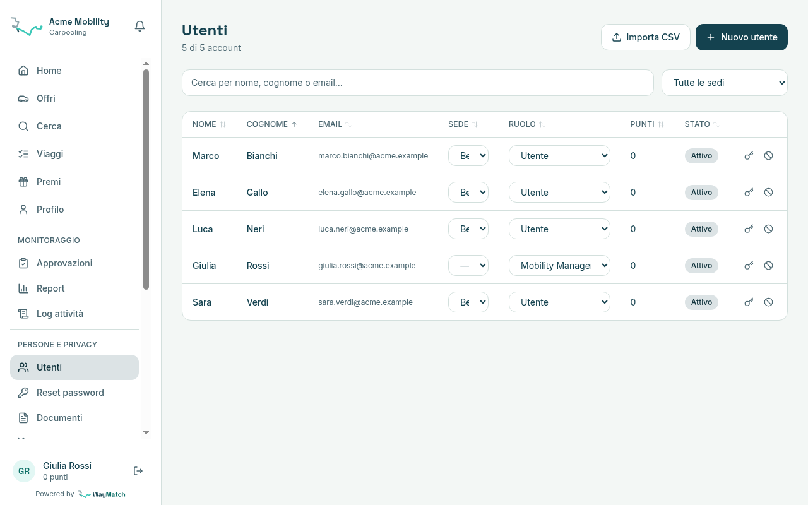
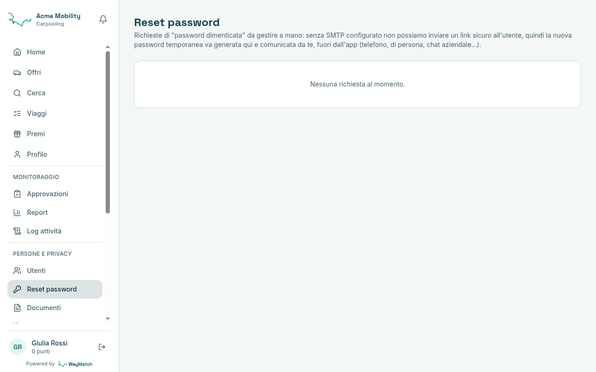
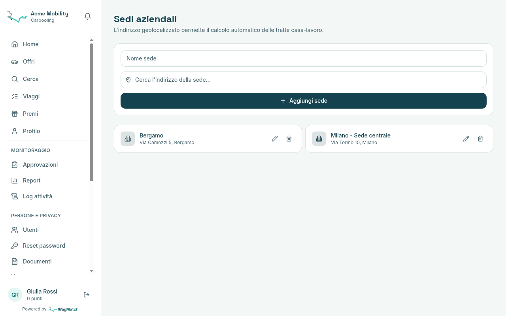
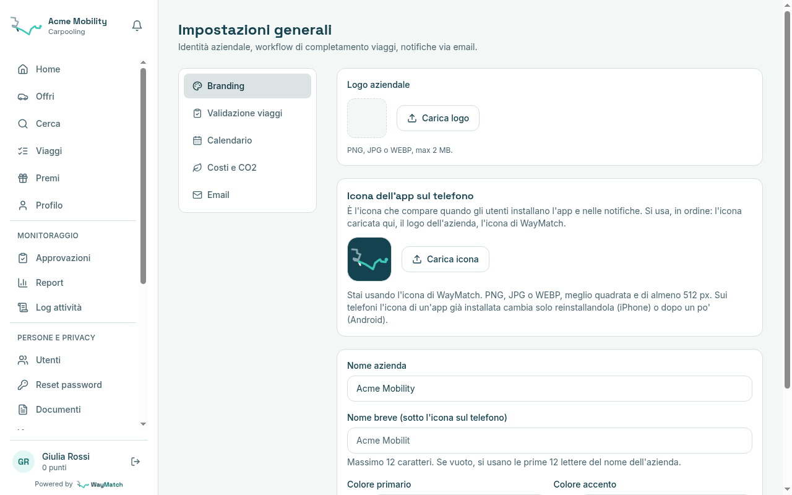
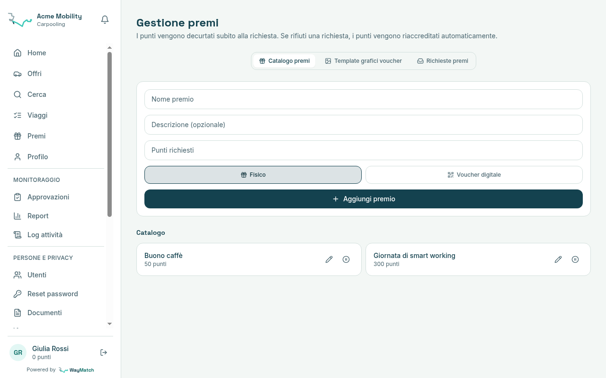
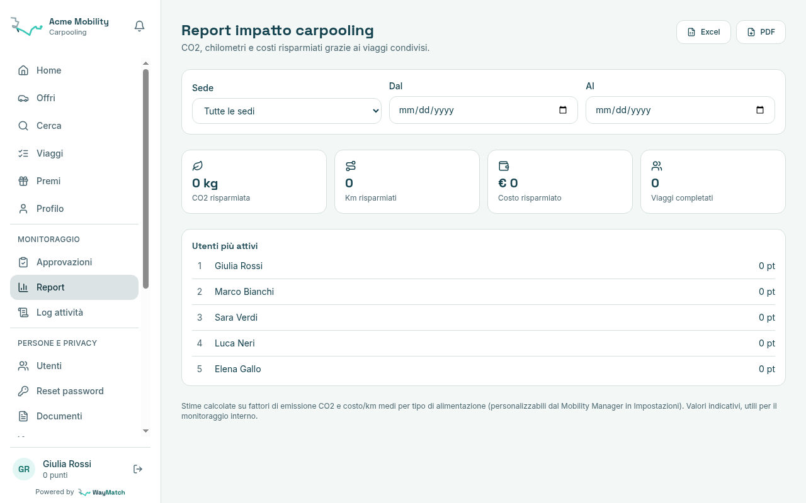
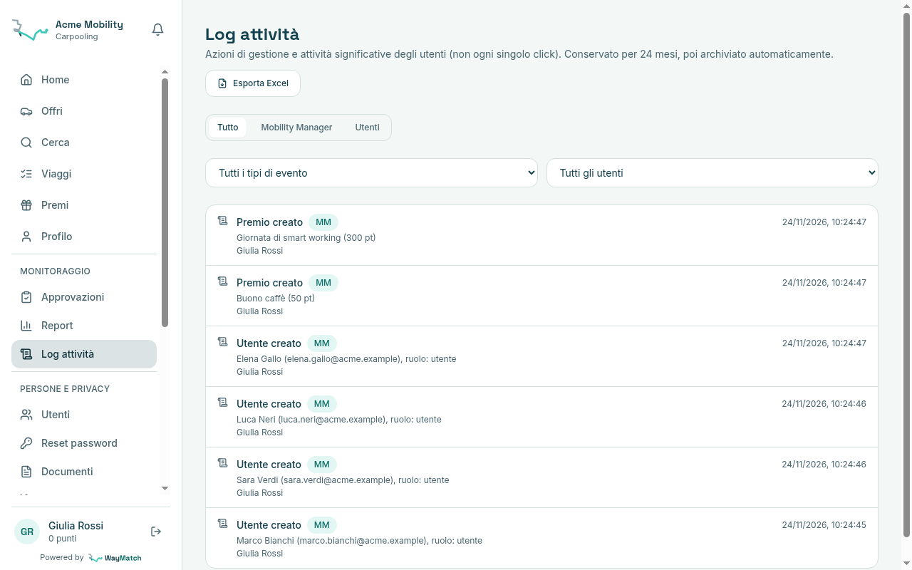
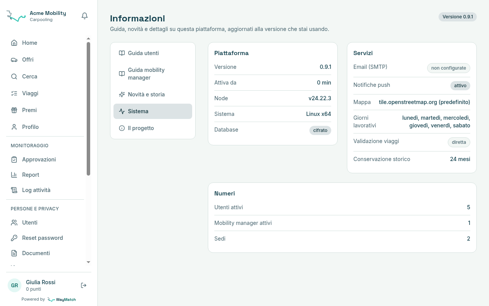

# Guida per il Mobility Manager

Il Mobility Manager gestisce l'app per l'azienda: utenti, sedi, regole, premi e documenti. Il
**supervisor** vede solo i report. Tutte le funzioni di gestione sono nel menu laterale, sotto la
voce Home, divise per area.

## Primo avvio (configurazione iniziale guidata)

Al primo accesso al sito compare la configurazione iniziale: nome dell'azienda, i tuoi dati (diventi il primo
Mobility Manager) e le sedi. Si può sempre completare dopo da **Sedi** e **Impostazioni
generali**. La configurazione iniziale si fa una volta sola.

L'app impedisce di **lasciare l'azienda senza Mobility Manager**: l'ultimo non può essere
disattivato né declassato, e nessuno può disattivare il proprio account. Per sostituirti, prima
nomina un altro Mobility Manager.

## Utenti



**Utenti** → crei un account (nome, cognome, email, **password provvisoria**, ruolo, sede) o
modifichi, disattivi e riattivi quelli esistenti. Chi ha una password provvisoria deve cambiarla al
primo accesso: finché non lo fa, l'app non gli permette di fare altro.

Se la **foto del profilo** di qualcuno non è appropriata, la rimuovi dall'icona accanto alle azioni
dell'utente: l'operazione resta nel log attività e l'utente può caricarne un'altra.

**Import da CSV** per molti utenti insieme. Intestazione e separatore virgola:

```
Nome,Cognome,email,passtemporanea,ruolo,sede
Mario,Rossi,mario.rossi@azienda.it,Provv-Password-123!,utente,Milano - Sede centrale
```

- Un file normale **crea** i nuovi utenti e **aggiorna** nome, cognome e ruolo di quelli
  esistenti (senza toccare le loro password). Attenzione: se la colonna `ruolo` manca o è vuota,
  gli utenti esistenti diventano "utente".
- Un file il cui **nome contiene la sequenza «cessat»**, in qualunque punto e senza distinguere
  maiuscole e minuscole (per esempio `cessati-novembre.csv`), **disattiva** gli utenti elencati per
  email. Attenzione: la sequenza vale anche dentro altre parole (`elenco_processato.csv` contiene
  «cessat»): dai ai file normali un nome che non la contenga. Non c'è nessuna disattivazione
  automatica fuori da questa modalità.
- Se un file toglierebbe l'ultimo Mobility Manager, viene rifiutato per intero.

## Reset password



Se l'azienda non usa le email, le richieste di recupero password degli utenti arrivano qui. Per
ognuna **generi una password temporanea** e la comunichi all'utente (di persona o per telefono, non
per email): dovrà cambiarla al primo accesso. Puoi anche reimpostare la password di un utente
direttamente da **Utenti**.

## Sedi



Le sedi sono le destinazioni (e i filtri) dei passaggi. Per ognuna indichi il nome e scegli l'indirizzo dal
completamento automatico: l'app ne ricava le coordinate.

## Impostazioni generali



Cinque schede:
- **Branding**: logo, nome dell'azienda e colori. Quello che carichi qui è **l'identità della tua
  azienda**: compare nell'intestazione e nella pagina di accesso. Il logo si può cambiare o rimuovere
  (al suo posto torna il simbolo di WayMatch). Il marchio di WayMatch, la
  piattaforma, resta discreto ("Powered by" in fondo al menu) e nella pagina Informazioni. Lo sfondo
  e i testi non si personalizzano, così la lettura è sempre confortevole. Se scegli un colore primario con
  poco contrasto (sotto 4,5:1) compare un avviso con la variante più scura più vicina, da applicare con un tocco;
  il colore accento si adatta da solo.
  **Icona dell'app**: è quella che compare sul telefono quando gli utenti installano l'app, nel browser e nelle
  notifiche. Si usa, in ordine, l'icona quadrata che carichi qui, il logo dell'azienda, l'icona di WayMatch. Un logo
  largo in un quadrato risulta piccolo: per un buon risultato carica un'icona quadrata (almeno 512 px). Sui telefoni
  l'icona di un'app già installata cambia solo reinstallandola (iPhone) o dopo un po' (Android). Puoi anche scegliere il
  **nome breve** (massimo 12 caratteri) mostrato sotto l'icona.
- **Validazione viaggi**: se il completamento di un viaggio deve essere approvato da te prima di
  assegnare i punti.
- **Calendario**: i **giorni lavorativi** dell'azienda (predefiniti: lunedì-sabato). Passaggi e
  turni fissi si possono creare solo in quei giorni: se l'azienda lavora anche la domenica, o
  non lavora il sabato, cambialo qui. Un passaggio già creato resta com'è; un turno fisso smette
  di generare passaggi nei giorni tolti.
- **Costi e CO2**: i fattori usati per stimare il risparmio.
- **Email**: stato e prova dell'invio email (se configurato).

## Premi, contest e punteggio



La gamification (punti, premi, classifiche e contest) è **facoltativa** e sulle installazioni nuove
parte **spenta**: c'è chi usa WayMatch solo per mettere in contatto i colleghi. La accendi o la spegni
da **Impostazioni generali → Gamification**. Spenta, non si assegnano punti, le pagine di punti, premi
e contest non si vedono (nemmeno il gruppo Gamification del menu) e la classifica dei report conta i
viaggi invece dei punti; i viaggi continuano a contare per i report. Punti e storico restano: riaccesa,
si riparte da lì. Le richieste di premio ancora aperte restano da gestire: la scheda Gamification te
lo ricorda, con il collegamento a Gestione premi.

**Azzerare i punteggi.** Dalla stessa scheda puoi riportare a zero i punti di tutti, in qualsiasi
momento (per esempio a inizio anno o quando cambiano le regole); quando accendi o spegni la
gamification te lo propone. Prima di confermare vedi quanti premi sono stati consegnati, quanti sono
approvati ma da consegnare e quanti in attesa, e puoi **scaricare l'elenco dei riscatti in Excel**
(chi, quale premio, stato, codice del voucher) per consegnare a mano quelli rimasti. Per i premi non
ancora consegnati scegli tu: **tenerli** (restano da consegnare) o **annullarli** (chi li aveva
chiesti riceve un avviso, i punti non tornano). Saldi, classifiche e contest ripartono da zero; lo
storico resta, per i report e per l'export dei dati personali. L'operazione non si annulla. Un
riscatto chiesto prima dell'azzeramento e rifiutato dopo non ridà punti. Conviene avvisare i
colleghi prima: l'app non manda un messaggio a tutti.

- **Gestione premi**: il catalogo. Un premio può essere "fisico" (lo consegni tu) o un **voucher
  digitale**, con un codice generato all'approvazione e stampato su un'immagine modello che
  carichi tu. Le richieste di riscatto le approvi o rifiuti da qui; se rifiuti, i punti tornano
  all'utente.
- **Contest**: gare a tempo con classifica.
- **Regole punteggio**: quanti punti per offrire un passaggio, per ogni viaggio come autista o
  passeggero, bonus per chilometri e per "macchina piena". Nella stessa pagina puoi **assegnare punti a mano**,
  con storico.

## Approvazioni, report e log

- **Approvazioni** (se attiva la validazione): i viaggi completati in attesa del tuo ok.



- **Report**: chilometri e CO2 risparmiati, costo risparmiato, viaggi completati, utenti più attivi,
  filtrabili per sede e periodo. Esporti in **Excel** o **PDF**.



- **Log attività**: chi ha fatto cosa (gestione di utenti, sedi, premi, impostazioni e una scelta
  delle azioni degli utenti). Con più Mobility Manager ogni voce dice chi ha agito. Filtri per
  categoria (Mobility Manager o utenti), tipo di evento, utente, **area** (utenti e accessi,
  passaggi e turni, punti, premi e contest, documenti, impostazioni e sedi, privacy), **sede** di
  chi ha agito, **periodo** e **ricerca libera** nei dettagli; l'esportazione in Excel usa gli
  stessi filtri. I dati più vecchi vengono archiviati secondo la ritenzione impostata dall'IT (24
  mesi per impostazione predefinita). Gli accessi dei colleghi (quando entrano ed escono
  dall'app) **non** sono qui: stanno nel log tecnico per l'IT, a fini di sicurezza; qui vedi solo
  quando un account viene bloccato per troppi tentativi.

## Informazioni → Sistema



In **Informazioni** trovi anche la scheda **Sistema**, visibile solo a te: la versione dell'app, da
quanto è attiva, se il database è cifrato, quali servizi sono attivi (email, notifiche push), il
fornitore delle mappe, i giorni lavorativi, la conservazione dello storico e qualche numero
(utenti, Mobility Manager, sedi). Non mostra chiavi né dati riservati: serve a capire in un colpo
d'occhio come è configurata l'installazione, per esempio quando devi chiedere aiuto all'IT.

Alla voce **Aggiornamenti** vedi se è uscita una nuova versione di WayMatch, con il link alle note
di rilascio: il server controlla una volta al giorno e, quando ne esce una, ricevi anche un avviso
(categoria «Nuove versioni di WayMatch» nelle preferenze di notifica). L'installazione la fa l'IT,
seguendo la guida di installazione (sezione «Aggiornare»). L'IT può disattivare il controllo: in
quel caso la voce dice «controllo disattivato».

## Documenti e consensi

Da **Documenti** pubblichi testi (informativa privacy, dichiarazione del conducente...) o PDF che
gli utenti devono accettare con una spunta. Una nuova versione richiede una nuova accettazione. Un
documento può essere **generale** (chiesto a tutti al primo accesso) o **per chi offre un
passaggio** (chiesto la prima volta che si pubblica un'offerta). Le accettazioni sono registrate
con data e ora.

Una nuova versione di un documento per chi offre un passaggio mette **in pausa** i turni fissi di
chi non l'ha ancora accettata: le corse già generate restano (sono state offerte con le condizioni
di allora), ma non se ne generano di nuove, un turno sospeso non si riattiva e una data saltata
non si ripristina, nemmeno da parte tua. Il conducente riceve un avviso; appena accetta, i turni riprendono e le corse mancanti delle
due settimane successive vengono create subito. Dato che i turni generano le corse con due
settimane di anticipo, chi accetta entro quel tempo non lascia buchi in calendario.

## Cancellazioni (privacy)

Da **Cancellazioni** gestisci le richieste degli utenti di cancellare i propri dati (GDPR). Se
accetti, l'utente viene **anonimizzato**: nome ed email spariscono, l'accesso è disabilitato, i
passaggi futuri che offriva vengono annullati (i passeggeri avvisati) e le sue prenotazioni
liberate. Lo storico dei viaggi condivisi resta, senza dati personali. Non si può anonimizzare
l'ultimo Mobility Manager.

## Buone pratiche

- Cambia la password provvisoria di un nuovo Mobility Manager subito.
- Comunica le password temporanee solo a voce o con un canale riservato.
- Tieni almeno **due** Mobility Manager attivi.
- Controlla ogni tanto il log attività.
