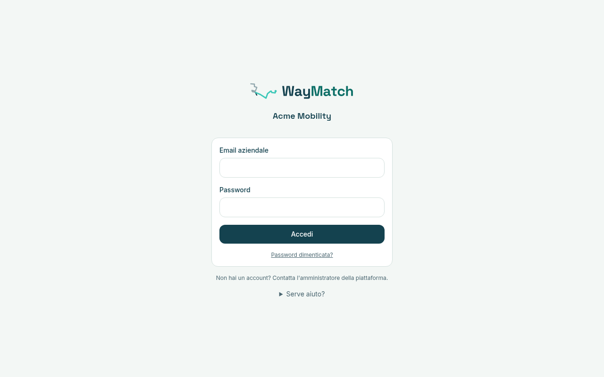
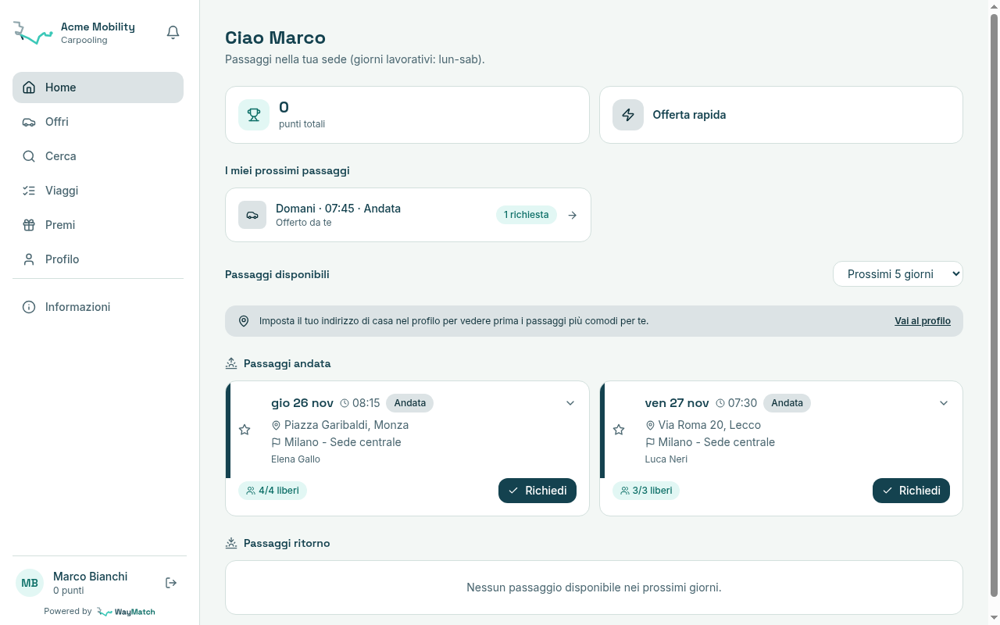
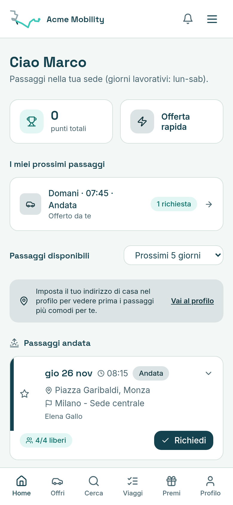
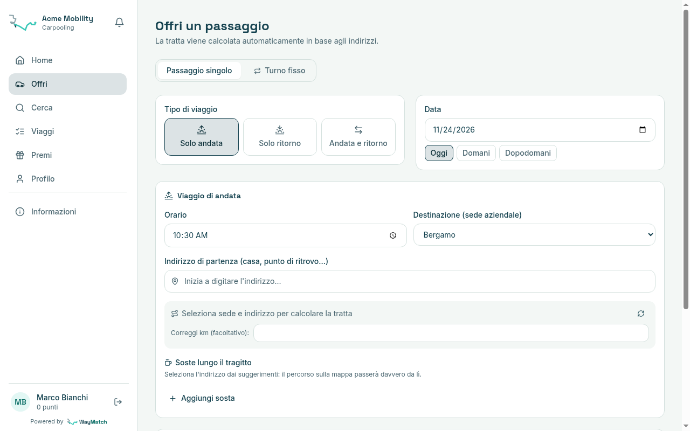
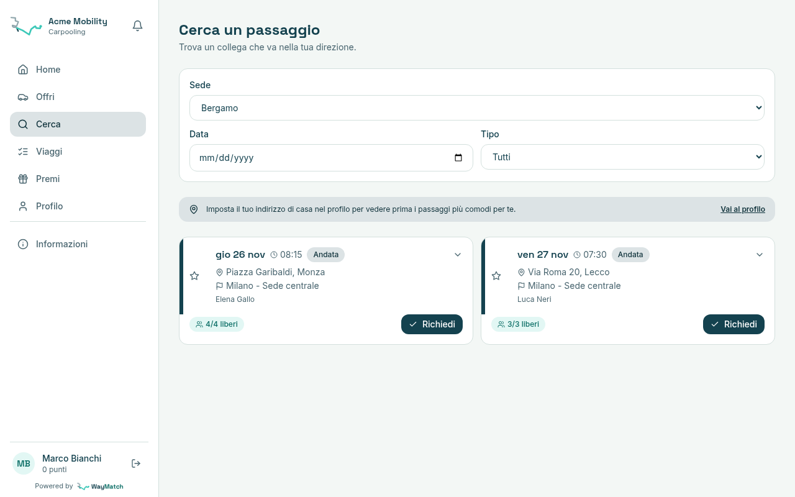
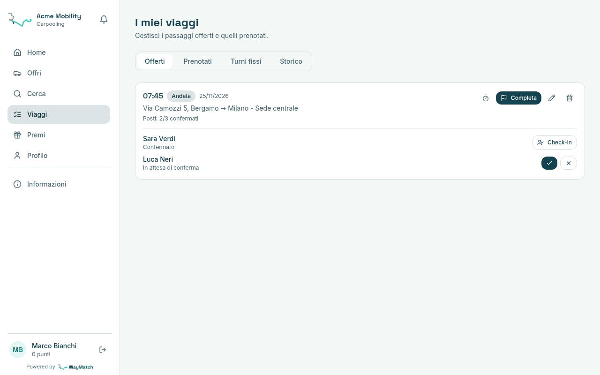
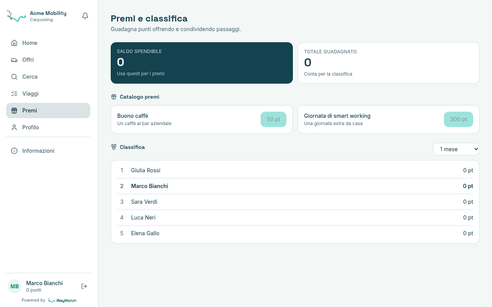
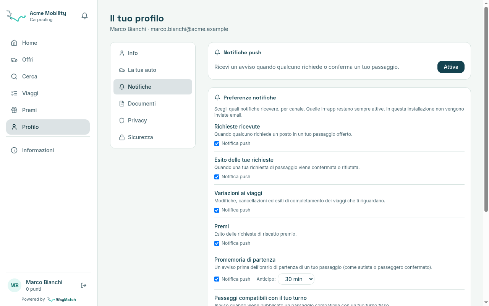
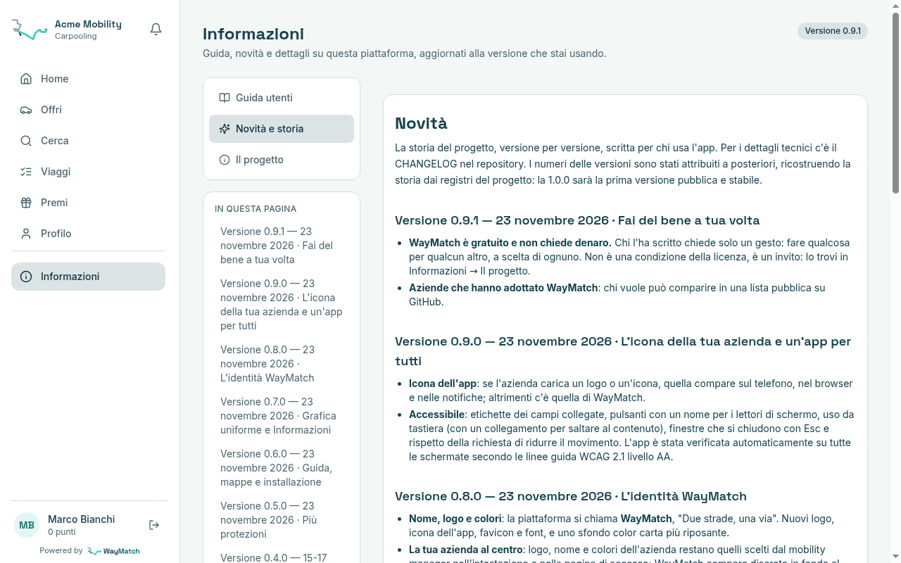
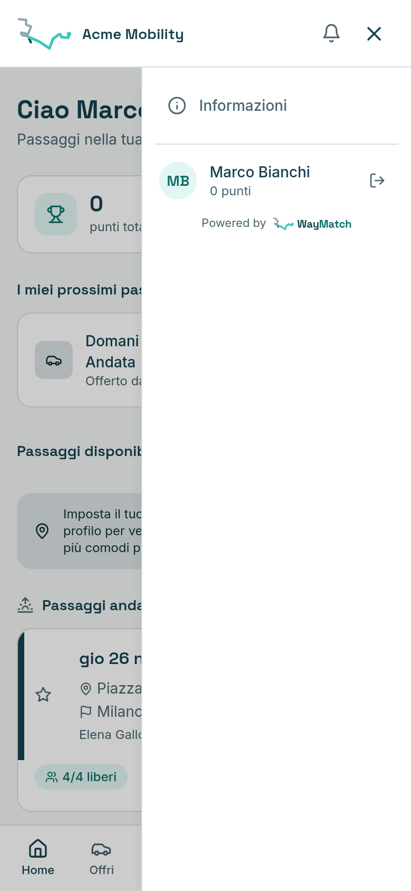

# Guida per chi usa l'app

Per dipendenti che offrono o cercano un passaggio con **WayMatch**, la piattaforma di carpooling della tua azienda. L'app si apre dal browser (PC o telefono) e si
può installare come un'app dalla schermata Home del telefono.

## Primo accesso

1. Il mobility manager ti crea l'account e ti comunica un'**email** e una **password
   provvisoria**.
2. Accedi. Prima di poter usare l'app ti viene chiesto di **scegliere una nuova password**: la
   conosci solo tu. Servono almeno **14 caratteri** (le regole sono scritte sotto il campo).
3. Se l'azienda ha pubblicato dei documenti (per esempio l'informativa privacy), devi
   **accettarli** con una spunta. Potrai riguardarli dal Profilo.

**Password dimenticata?** Dal link nella pagina di accesso invii la richiesta. Se l'azienda ha
attivato le email, ricevi un link; altrimenti il mobility manager riceve la richiesta e ti assegna
una password provvisoria, che dovrai cambiare al primo accesso.

## Home

La Home mostra i tuoi **punti**, **I miei prossimi passaggi** (quelli che offri e quelli a cui hai
aderito) e i **passaggi disponibili** nella tua sede nei prossimi giorni. Il pulsante **Offerta
rapida** crea un passaggio in pochi tocchi: usa la sede e l'indirizzo di casa salvati nel profilo
(servono entrambi), così scegli solo tipo, data, orario e posti. Se imposti il tuo indirizzo di casa nel profilo,
i passaggi il cui percorso passa vicino a casa tua compaiono per primi, con un'etichetta.

Dal telefono la navigazione è nella barra in basso:

## Offrire un passaggio

Da **Offri** scegli andata, ritorno o entrambi, la data, l'orario, i posti disponibili e l'indirizzo
di partenza (con completamento automatico). La destinazione è una delle sedi dell'azienda. L'app
calcola da sola il percorso e i chilometri e mostra la mappa. Puoi aggiungere **soste
intermedie** (per esempio una pausa) e delle note.

- Non si possono creare passaggi per un orario già passato, né in un giorno che l'azienda non
  prevede (di norma la domenica: lo decide il mobility manager).
- **Turni fissi**: se fai sempre lo stesso tragitto, impostalo in **Viaggi → Turni fissi**
  (giorni della settimana, orario, indirizzo): l'app crea i passaggi per le due settimane
  successive. Puoi saltare una data (ferie, malattia) senza sospendere tutto il turno.
- Puoi modificare un passaggio ancora attivo: chi aveva già chiesto un posto viene avvisato.

## Cercare e prenotare

In **Cerca** filtri per sede, data e tipo. **Richiedi** chiede un posto; se vuoi puoi indicare dove
salire o scendere tra le soste. L'autista conferma o rifiuta e ricevi una notifica. Se il passaggio
è al completo la richiesta entra in **lista d'attesa**: se si libera un posto, il primo della lista
viene promosso automaticamente.

## I miei viaggi

Qui trovi i viaggi in programma, i **turni fissi** e lo **storico**. Come autista:
- confermi o rifiuti le richieste;
- il giorno del viaggio segni chi è **realmente salito** (check-in);
- a viaggio fatto lo **completi**: i punti vengono assegnati solo ai viaggi avvenuti. Se l'azienda
  ha attivato la validazione, il viaggio resta "in approvazione" finché un mobility manager lo
  approva.
- puoi segnalare un **ritardo**, e annullare un passaggio (i passeggeri vengono avvisati).

## Punti, classifica e premi

Ogni viaggio condiviso ti fa guadagnare punti (le regole le decide l'azienda). In **Premi** vedi la
classifica, i contest in corso e il catalogo premi. Il riscatto toglie subito i punti; se il premio
viene rifiutato i punti ti tornano. Alcuni premi sono **voucher digitali** con un codice.

## Profilo

Il Profilo ha sei schede:
- **Info**: i tuoi dati, la sede e l'indirizzo di casa.
- **La tua auto**: marca, modello, anno, cilindrata, alimentazione. Serve a stimare CO2 e costi
  risparmiati e a farti riconoscere dai passeggeri.
- **Notifiche**: per ogni tipo di avviso scegli dove riceverlo: **App** (la campanella dentro
  l'app), **Push** (il telefono o il computer ti avvisa anche ad app chiusa) e, se l'azienda ha
  attivato le email, **Email**. Togliendo tutte le spunte quell'avviso non arriva più.
- **Documenti**: i documenti che hai accettato, con data e ora.
- **Sicurezza**: il cambio password e le **sessioni** attive (i dispositivi collegati): puoi
  chiuderle una per una o uscire da tutte.
- **Privacy**: puoi **scaricare tutti i tuoi dati** e **chiedere la cancellazione** dell'account.
  La richiesta la valuta il mobility manager: se accolta, il tuo profilo viene anonimizzato (i tuoi
  viaggi passati restano nello storico dei colleghi, senza i tuoi dati personali) e l'accesso
  viene disabilitato.

## Dove trovare questa guida

Nell'app, alla voce **Informazioni** del menu (dal telefono: icona del menu in alto a destra). Qui
trovi anche le **Novità** di ogni versione, la storia del progetto e i riferimenti per segnalare
problemi, e l'invito di chi ha scritto WayMatch: *è gratuito, fai del bene a tua volta*.

Dal telefono si apre con l'icona del menu in alto a destra, che diventa una X per chiuderlo:

## Problemi comuni

- **"Troppi tentativi"**: dopo alcuni errori di password l'account si blocca per qualche minuto.
  Riprova più tardi.
- **Non ricevo le notifiche push**: devi consentirle nel browser e attivarle dal Profilo. Su iPhone
  l'app va prima aggiunta alla schermata Home.
- **Non vedo passaggi**: controlla la sede e la data nei filtri. Si vedono solo i passaggi futuri.
